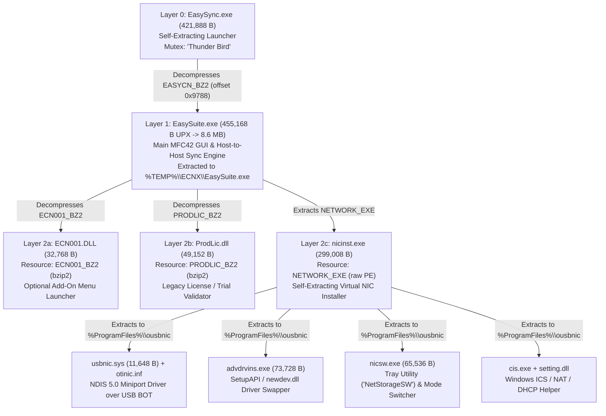
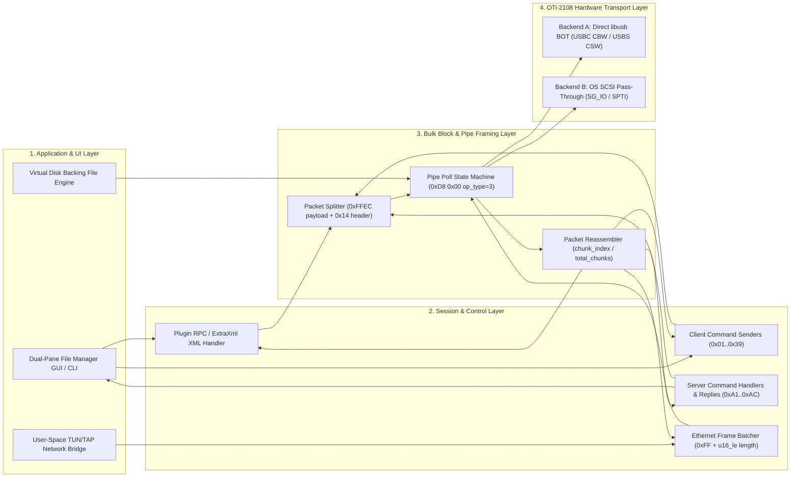

# OTi-2108 Clean-Room Specification — Part 0: Overview & System Architecture

## 1. Purpose and Clean-Room Scope

This specification suite defines the complete hardware transport, host-to-host wire protocol, user interface behavior, and virtual network adapter (Virtual NIC) mode-switching protocol required to build a **clean-room, cross-platform replacement** for the **OTi-2108 USB Host-to-Host Data Bridge** companion software (`EasySync.exe` v4.1.272.5 / `EasySuite.exe` v1.1.67.24, originally developed by Ours Technology Inc. / UR Technology Inc. and distributed by ASUSTeK Computer Inc.).

### 1.1 Suite Structure

| Document | Title | Scope |
| :--- | :--- | :--- |
| [00-overview-and-architecture.md](00-overview-and-architecture.md) | Overview & System Architecture | Hardware overview, legacy multi-layer binary inventory, legacy plugin/DRM boundary, and target cross-platform architecture. |
| [01-usb-and-scsi-transport-spec.md](01-usb-and-scsi-transport-spec.md) | USB & SCSI Pass-Through Transport Specification | USB descriptors (`0ea0:2108`), all 10 SCSI/vendor CDBs, sense code table, initialization sequence, link poll state machine, virtual disk backing, and dual transport (`libusb` BOT vs. OS SCSI pass-through). |
| [02-host-to-host-wire-protocol-spec.md](02-host-to-host-wire-protocol-spec.md) | Host-to-Host Wire Protocol Specification | 20-byte bulk block header, 64 KB packet splitter/reassembler, host query format (`0x01`), all Client Command opcodes (`0x01..0x39`), all Server Reply opcodes (`0xA1..0xAC`), 552-byte directory entry struct, and dynamic plugin RPC `<OTIMSG>` / `<ExtraXmlCommand>` XML protocols. |
| [03-application-functional-and-ui-spec.md](03-application-functional-and-ui-spec.md) | Application Functional & UI Specification | Dual-pane file manager UI, status indicators, menu/dialog specifications, file transfer workflows (overwrite pre-check, recursive batch sync, progress/cancel), and 11-locale string mappings. |
| [04-virtual-nic-and-mode-switch-spec.md](04-virtual-nic-and-mode-switch-spec.md) | Virtual NIC & Mode-Switch Specification | Transfer Line (`0x007F`) $\leftrightarrow$ Virtual NIC (`0x0044`) handshake, 34.5 KB (`0x8A00`) bulk transfer framing with `0xFF` payload marker, `[frame_len:u16_le][ethernet_frame]` batching, MAC address generation, and cross-platform user-space `TUN/TAP` architecture. |

---

## 2. OTi-2108 Hardware Overview

The **OTi-2108** (USB Vendor ID `0x0EA0`, Product ID `0x2108`) is a high-speed USB 2.0 Host-to-Host Data Bridge controller with an optional integrated NAND flash / virtual disk interface (shared with the OTi-2208 family).

### 2.1 Key Hardware Characteristics

1. **Dual Independent USB Device Ports:**
   - Each end of the bridge cable connects to a USB host (Host A and Host B) and enumerates independently as a standard **USB Mass Storage Class — Bulk-Only Transport (BOT)** device:
     + `idVendor`: `0x0EA0` (Ours Technology Inc.)
     + `idProduct`: `0x2108` (`OTi-2108` / `"Mass Storage Device"`)
     + `bInterfaceClass`: `0x08` (Mass Storage)
     + `bInterfaceSubClass`: `0x06` (SCSI Transparent Command Set)
     + `bInterfaceProtocol`: `0x50` (Bulk-Only Transport)
2. **Driverless Enumeration on Host OS:**
   - Because the OTi-2108 exposes a standard USB Mass Storage BOT interface (`0x08/0x06/0x50`), every operating system binds its built-in USB storage driver (`usbstor.sys` on Windows, `usb-storage` on Linux, `IOUSBMassStorageClass` on macOS) without requiring custom kernel drivers for file-transfer operation.
   - When the cable has embedded auto-run flash or virtual disk backing, it mounts as a removable disk or CD-ROM drive containing `EasySync.exe` and `EasySync.txt`.
3. **Internal Shared FIFO Buffer & Hardware Mailboxes:**
   - The bridge contains an internal hardware FIFO buffer (configurable from `256 KB` to `2 MB`, queried via vendor CDB `0xD8 0x00` `op_type=1` or custom flash signature `"OTiMing"` via `0xDB 0x28`).
   - All host-to-host communication—both **Transfer Line Mode** (file synchronization) and **Virtual NIC Mode** (Ethernet over USB)—is tunneled through vendor-specific 16-byte SCSI Command Descriptor Blocks (`0xF0`, `0xD8`, `0xD9`, `0xDA`, `0xDB`) terminated with the ASCII signature `"OT"` (`0x4F 0x54`) at CDB bytes 14 and 15.

---

## 3. Legacy Binary Packaging & Component Inventory

The original Windows software is packaged as a three-layer self-extracting hierarchy inside `EasySync.exe`.

### 3.1 Detailed Component Inventory

| Layer | Binary Name | Size (Bytes) | Format / Compression | Role in Legacy Suite | Clean-Room Disposition |
| :--- | :--- | ---: | :--- | :--- | :--- |
| **0** | `EasySync.exe` | `421,888` | Win32 PE (`MSVCRT`) | Checks named mutex `"Thunder Bird"`. If already running, sends `WM_USER` wakeup via `EnumWindows`; otherwise decompresses `bzip2` resource `EASYCN_BZ2` (`413,545` B at offset `0x9788`) to `%TEMP%\ECNX\EasySuite.exe` and runs it via `WinExec`. | **Omit wrapper**; modern cross-platform binary runs directly and uses standard single-instance lock. |
| **1** | `EasySuite.exe` | `455,168` (packed) `8,615,705` (unpacked) | Win32 PE (`MFC42.DLL`), packed with UPX 1.93 `NRV2E_LE32` | Core dual-pane file manager GUI, SPTI/ASPI transport layer, 64 KB bulk block framing engine, Client/Server command state machines, and dynamic plugin RPC parser (`<OTIMSG>` / `<ExtraXmlCommand>`). If launched from a removable/CD drive (`GetDriveTypeA == 2` or `5`), copies `EasySync.exe` and `EasySync.txt` to `%TEMP%\ECNX\` and re-executes so the removable drive is not locked. | **Core clean-room target** (fully specified in Parts 1, 2, and 3). |
| **2a** | `ECN001.DLL` | `32,768` | `bzip2` stream in `ECN001_BZ2` (`11,059` B) | Optional plugin DLL loaded dynamically via `LoadLibraryA("ECN001.dll")`. Exports `OTi_Dynamic_Lib_Authorize`, `OTi_Dynamic_Lib_Query`, and `OTi_Dynamic_Lib_IO` to populate the `"Add-On Function"` menu and launch external tools (`Post2208.exe` / `EasyBoot.exe` / `Mail.exe` / `PIM.exe`). | **Documented for context only** (see Section 4.1); omit or replace with optional plugin hook. |
| **2b** | `ProdLic.dll` | `49,152` | `bzip2` stream in `PRODLIC_BZ2` (`16,580` B) | Legacy DRM/trial helper (`Product Licensor 1.0`). Exports `CheckPermition`, `VerifyLicense`, `VerifyPassword`, and `InstallPath`. Checks `Software\Web storage\License` (`System3` key) and `EasySync.txt`. | **Excluded from clean-room implementation** (see Section 4.2). |
| **2c** | `nicinst.exe` | `299,008` | Raw PE in `NETWORK_EXE` (`1.1.67.24`) | Self-extracting archive that unpacks `ousbnic/` to `%ProgramFiles%\ousbnic`, checks `CheckExisting Device\0ea0&2108`, runs `advdrvins.exe`, and launches `nicsw.exe` (`IS` / `IC` / `I`). | **Replace Windows driver swap** with user-space Virtual NIC daemon or native TUN/TAP bridge (Part 4). |
| **3a** | `usbnic.sys` | `11,648` | Win2k/XP NDIS 5.0 Miniport (`USBD.SYS`, `NDIS.SYS`) | Implements a virtual 802.3 Ethernet adapter over the OTi-2108 USB Mass Storage BOT endpoints (`USBC` CBW / `USBS` CSW) using bridge mode `0x0044` and `0x8A00` (34.5 KB) bulk frame batches prefixed with opcode `0xFF`. | **Core protocol target** (wire protocol fully specified in Part 4). |
| **3b** | `advdrvins.exe` | `73,728` | Win32 PE (`SETUPAPI.dll`, `newdev.dll`) | Swaps the active Windows driver for `USB\VID_0EA0&PID_2108` between `usbstor.sys` (`-su`) and `usbnic.sys` (`otinic.inf`) using `UpdateDriverForPlugAndPlayDevicesA`. | **Legacy Windows mechanism**; documented in Part 4. |
| **3c** | `nicsw.exe` | `65,536` | Win32 PE (`MFC42.DLL`) | System tray utility (`NetStorageSW`) that coordinates ICS setup (`cis.exe`) and switches the OTi-2108 back from Virtual NIC mode to Transfer Line mode (`cis.exe r` + `AdvDrvIns.exe -su` + re-launching `EasySync.exe`). | **Functional behavior specified** in Part 4. |

---

## 4. Legacy Plugin (`ECN001.DLL`) and License (`ProdLic.dll`) Boundaries

### 4.1 `ECN001.DLL` Optional Add-On Interface
During initialization (`0x0041ADF8`), `EasySuite.exe` decompresses `ECN001_BZ2` to `ECN001.dll` and resolves three C exports:
1. `int OTi_Dynamic_Lib_Authorize(const char *magic)`:
   - Verifies the caller passes the exact 10-byte ASCII string `"OTiProduct"`. Returns `1` if valid, `0` otherwise.
2. `int OTi_Dynamic_Lib_Query(char *out_buf)`:
   - Queries whether optional companion suites (for OTi-2208 flash disks: `"Start OTi AP\n"`, `"Start Mail AP\n"`, `"Start PIM AP\n"`, `"Start Security AP\n"`, `"Start Sync AP\n"`) are installed under `HKLM\Software\...` (`Path`, `Command1..Command4`).
3. `int OTi_Dynamic_Lib_IO(int cmd_index, ...)`:
   - Launches the external executable (`Post2208.exe` or `EasyBoot.exe`) via `CreateProcessA`.

> [!NOTE]
> On a standalone OTi-2108 host-to-host bridge cable without the OTi-2208 flash companion suite installed, `ECN001.DLL` leaves the `"Add-On Function"` menu disabled/empty. A clean-room implementation does not need to implement `ECN001.DLL`.

### 4.2 `ProdLic.dll` Legacy License / Trial Check
`EasySuite.exe` decompresses `PRODLIC_BZ2` to `ProdLic.dll` (`Product Licensor 1.0`) and invokes `VerifyLicense` / `CheckPermition`. It checks `HKLM\Software\Web storage\License` (`System3` value) and `EasySync.txt` (an encrypted license token file bundled alongside `EasySync.exe`), displaying a 30-day trial prompt if missing.
- **Clean-Room Rule:** All license/trial checks and `ProdLic.dll` interactions are **excluded** from the clean-room target specification.

---

## 5. Clean-Room Cross-Platform Architecture

To reproduce all capabilities of `EasySync.exe` and `usbnic.sys` across Linux, macOS, and Windows without kernel driver signing or disruptive OS driver swapping, a clean-room implementation should be structured into four decoupled layers:

### 5.1 Unified Framing Insight
A critical architectural finding from reverse engineering both `EasySuite.exe` and `usbnic.sys` is that **both Transfer Line mode and Virtual NIC mode share the exact same 20-byte (`0x14`) Bulk Block Header** over CDB `0xD9 0x2A` (Bulk Write) and `0xD9 0x28` (Bulk Read):

| Offset | Type | Field Name | Transfer Line Mode (`EasySuite.exe`) | Virtual NIC Mode (`usbnic.sys`) |
| :--- | :--- | :--- | :--- | :--- |
| `+0x00` | `uint32_le` | `block_seq_id` | Monotonic per-block counter (`[this+0x608]`) | `0x00000000` |
| `+0x04` | `uint32_le` | `msg_seq_id` | Monotonic per-message counter (`[this+0x60C]`) | `0x00000000` |
| `+0x08` | `uint32_le` | `chunk_index` | `0 .. total_chunks - 1` | `0x00000000` |
| `+0x0C` | `uint32_le` | `total_chunks` | Total `0x10000` blocks in message (`>= 1`) | `0x00000001` |
| `+0x10` | `uint32_le` | `chunk_payload_len` | Payload bytes in this block (`1 .. 0xFFEC`) | `0x00008A00` (`35,328`) |
| `+0x14` | `uint8` | `payload_opcode` | `0x01..0x39` (Client) or `0xA1..0xAC` (Server) | `0xFF` (Ethernet Frame Batch) |

Because both modes use the same USB endpoints, the same vendor CDBs (`0xF0`, `0xD8 0x00`, `0xD8 0x01`, `0xD9 0x28`, `0xD9 0x2A`), and the same 20-byte block header, a single cross-platform user-space engine can seamlessly support **both** dual-pane file synchronization (`mode = 0x007F`) and virtual Ethernet networking (`mode = 0x0044`) without swapping kernel drivers!
