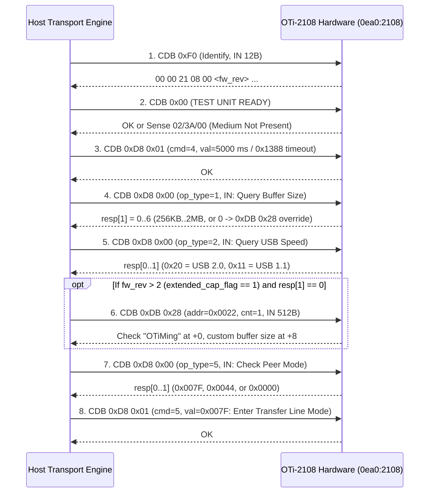

# OTi-2108 Clean-Room Specification — Part 1: USB & SCSI Pass-Through Transport

## 1. USB Device Enumeration & Descriptors

Each host port of the **OTi-2108** enumerates as a USB 2.0 High-Speed (480 Mbps) or USB 1.1 Full-Speed (12 Mbps) Mass Storage Class device using **Bulk-Only Transport (BOT)**.

### 1.1 Device & Interface Identifiers

| Descriptor Field | Value | Description |
| :--- | :--- | :--- |
| `idVendor` | `0x0EA0` | Ours Technology Inc. (OTi / UR Technology Inc.) |
| `idProduct` | `0x2108` | OTi-2108 USB Host-to-Host Data Bridge |
| `bDeviceClass` | `0x00` | Defined at Interface level |
| `bInterfaceNumber` | `0x00` | Single Mass Storage interface |
| `bInterfaceClass` | `0x08` | USB Mass Storage Class |
| `bInterfaceSubClass` | `0x06` | SCSI Transparent Command Set |
| `bInterfaceProtocol` | `0x50` | Bulk-Only Transport (BOT) |

### 1.2 Endpoint Layout
As verified in `usbnic.sys` (`0x00011056..0x00011120`), the active configuration exposes two Bulk endpoints (plus an optional Interrupt endpoint unused by the host-to-host protocol):
- **Bulk IN Endpoint** (`bEndpointAddress & 0x80 != 0`, `bmAttributes == 0x02`): Used for BOT Data-In stages and 13-byte Command Status Wrapper (`USBS` CSW) reads. Max packet size is `512` bytes on USB 2.0 High-Speed or `64` bytes on USB 1.1 Full-Speed.
- **Bulk OUT Endpoint** (`bEndpointAddress & 0x80 == 0`, `bmAttributes == 0x02`): Used for 31-byte Command Block Wrapper (`USBC` CBW) writes and BOT Data-Out stages.

---

## 2. Dual Transport Implementation Architecture

A cross-platform clean-room implementation should support two interchangeable transport backends behind a single CDB execution interface:

```python
def execute_cdb(
    cdb: bytes,                 # 6, 10, or 16-byte CDB
    direction: Literal["NONE", "IN", "OUT"],
    data_or_length: bytes | int,
    timeout_ms: int,
) -> tuple[int, bytes, tuple[int, int, int]]:
    """Returns (status, data_in, (sense_key, asc, ascq))."""
```

### 2.1 Backend A: Direct `libusb` Bulk-Only Transport (Recommended Cross-Platform Default)
Using `libusb` (or `PyUSB` / `rusb` / `gousb`), a user-space application can detach the OS storage driver (`libusb_detach_kernel_driver` on Linux) and talk directly to the OTi-2108 Bulk OUT and Bulk IN endpoints. This works identically for **both** Transfer Line mode (`0x007F`) and Virtual NIC mode (`0x0044`) without needing root block-device discovery or kernel drivers.

#### 2.1.1 Command Block Wrapper (CBW — 31 Bytes, Little-Endian)
Constructed identically to `usbnic.sys` (`0x0001199C..0x00011C60`):

| Offset | Size | Type | Field | Value / Rule |
| :--- | ---: | :--- | :--- | :--- |
| `+0x00` | 4 | `uint32_le` | `dCBWSignature` | `0x43425355` (`"USBC"`) |
| `+0x04` | 4 | `uint32_le` | `dCBWTag` | `0x08210827` (constant used by `usbnic.sys`, or monotonic counter) |
| `+0x08` | 4 | `uint32_le` | `dCBWDataTransferLength` | Byte count of Data Stage (`0` if no data stage) |
| `+0x0C` | 1 | `uint8` | `bmCBWFlags` | `0x80` if Data-In (`direction == "IN"` and length > 0), else `0x00` |
| `+0x0D` | 1 | `uint8` | `bCBWLUN` | `0x00` |
| `+0x0E` | 1 | `uint8` | `bCBWCBLength` | `0x10` (16 bytes for all `"OT"` vendor CDBs; `0x06` or `0x0A` for standard SCSI) |
| `+0x0F` | 16 | `bytes[16]` | `CBWCB` | 16-byte CDB (zero-padded if 6 or 10 bytes) |

#### 2.1.2 Data Stage & Command Status Wrapper (CSW — 13 Bytes, Little-Endian)
1. Write the 31-byte CBW to the **Bulk OUT** endpoint.
2. If `dCBWDataTransferLength > 0`:
   + If `bmCBWFlags == 0x80` (`IN`): Read `dCBWDataTransferLength` bytes from the **Bulk IN** endpoint.
   + If `bmCBWFlags == 0x00` (`OUT`): Write `dCBWDataTransferLength` bytes to the **Bulk OUT** endpoint.
3. Read the 13-byte CSW from the **Bulk IN** endpoint (`usbnic.sys` `0x00011B3A`):

   | Offset | Size | Type | Field | Expected Value |
   | :--- | ---: | :--- | :--- | :--- |
   | `+0x00` | 4 | `uint32_le` | `dCSWSignature` | `0x53425355` (`"USBS"`) |
   | `+0x04` | 4 | `uint32_le` | `dCSWTag` | Matches `dCBWTag` (`0x08210827`) |
   | `+0x08` | 4 | `uint32_le` | `dCSWDataResidue` | Unprocessed byte count (`0` on full transfer) |
   | `+0x0C` | 1 | `uint8` | `bCSWStatus` | `0x00` = Command Passed, `0x01` = Command Failed (Check Condition), `0x02` = Phase Error |

4. **Auto-Sense on `bCSWStatus == 0x01`:** When using direct `libusb` BOT, if `bCSWStatus == 0x01`, the transport layer MUST immediately issue a standard 6-byte SCSI `REQUEST SENSE` CDB (`03 00 00 00 12 00`, `bmCBWFlags = 0x80`, `dCBWDataTransferLength = 18`) to retrieve the 18-byte sense buffer (`sense_key = sense[2] & 0x0F`, `asc = sense[12]`, `ascq = sense[13]`).

#### 2.1.3 USB BOT Timeout & Error Recovery
A USB timeout during the BOT Data stage or CSW stage leaves the OTi-2108 bridge's Bulk-Only Transport state machine desynchronized until standard USB Mass Storage **BOT Reset Recovery** is issued:
1. Send a **Bulk-Only Mass Storage Reset** class-specific control transfer on Endpoint 0:
   + `bmRequestType = 0x21` (Host-to-Device, Class, Interface)
   + `bRequest = 0xFF` (`BULK_ONLY_MASS_STORAGE_RESET`)
   + `wValue = 0x0000`, `wIndex = 0x0000` (`bInterfaceNumber`), `wLength = 0`
2. Clear any halted/stalled state (`CLEAR_FEATURE(ENDPOINT_HALT)` / `libusb_clear_halt`) on both the **Bulk IN** and **Bulk OUT** endpoints before issuing the next CBW.

### 2.2 Backend B: OS SCSI Pass-Through (`SG_IO` / `SPTI`)
When the OS mass-storage driver remains bound to the OTi-2108:
- **Linux (`SG_IO`):** Open `/dev/sgX` (or `/dev/srX` / `/dev/sdX`) with `O_RDWR | O_NONBLOCK` and issue `ioctl(fd, SG_IO, &sg_io_hdr)`. The Linux kernel automatically issues `REQUEST SENSE` on Check Condition and populates `sbp`.
- **Windows (`SPTI`, `EasySuite.exe` `0x00431A44`):** Open `\\.\X:` with `GENERIC_READ | GENERIC_WRITE`, `FILE_SHARE_READ | FILE_SHARE_WRITE`, `OPEN_EXISTING`. Use `DeviceIoControl` with:
    + `IOCTL_SCSI_PASS_THROUGH` (`0x0004D004`) for inline buffers (`TEST UNIT READY` at `0x00431E69`), or
    + `IOCTL_SCSI_PASS_THROUGH_DIRECT` (`0x0004D014`) with a 112-byte (`0x70`) struct (`Length = 0x2C`, `PathId = 0xFF`, `TargetId = 0xFF`, `Lun = 0xFF`, `SenseInfoLength = 0x18`, `SenseInfoOffset = 0x30`, `DataIn = 0 (OUT) | 1 (IN) | 2 (NONE)`).

---

## 3. Complete Catalog of SCSI & OTi-2108 Vendor CDBs

All OTi-2108 vendor-specific CDBs are **16 bytes long** (`bCBWCBLength = 16`) and MUST end with the 2-byte ASCII magic `"OT"` (`0x4F, 0x54`) at bytes 14 and 15.

### 3.1 Summary Table of All 10 CDBs

| # | Opcode & Subcmd | Name | Direction | Transfer Size | Timeout | `EasySuite.exe` VA | `usbnic.sys` VA |
| :-: | :--- | :--- | :---: | :---: | :---: | :--- | :--- |
| 1 | `0x00` | `TEST UNIT READY` (6-byte) | `NONE` | `0` B | `50` s | `0x00431E04` | — |
| 2 | `0x28` | `READ(10)` (10-byte) | `IN` | `512` / `2048` B | `2` s | `0x00432801` | — |
| 3 | `0xF0 0x00` | **Identify OTi-2108** | `IN` | `12` B (`0x0C`) | `2` s | `0x00431EDF` | `0x0001199C` |
| 4 | `0xD8 0x00` | **Read Bridge Register / Poll** | `IN` | `8` B (`2`/`7` in `usbnic`) | `4` s | `0x00432007` | `0x00011A32` |
| 5 | `0xD8 0x01` | **Write Bridge Command / Mode** | `OUT`/`NONE` | `0` B | `4` s | `0x00432102` | `0x00011AC2` |
| 6 | `0xD9 0x28` | **Bulk Pipe Read** | `IN` | `65,536` B (`0x10000`) or `35,328` B (`0x8A00`) | `10` s | `0x0043221D` | `0x00011B66` |
| 7 | `0xD9 0x2A` | **Bulk Pipe Write** | `OUT` | `65,536` B (`0x10000`) or `35,328` B (`0x8A00`) | `10` s | `0x004322FF` | `0x00011C14` |
| 8 | `0xDA 0x28` | **Virtual Disk Sector Read** (from bridge) | `IN` | `N * 512` B | `10` s | `0x004323F8` | — |
| 9 | `0xDA 0x2A` | **Virtual Disk Sector Write** (to bridge) | `OUT` | `N * 512` B | `10` s | `0x004324C4` | — |
| 10 | `0xDB 0x28` | **Vendor Flash / Config Read** | `IN` | `512` B (`0x200`) | `2` s | `0x004328FE` | — |

---

### 3.2 Byte-Level Specification of Each Vendor CDB

#### 3.2.1 `0xF0` — Identify OTi-2108 Bridge (`0x00431EDF` / `0x0001199C`)
Queries the hardware identity and firmware revision.

- **16-Byte CDB Layout:**

  ```text
  Byte:  00  01  02  03  04  05  06  07  08  09  10  11  12  13  14  15
  Hex:   F0  00  00  00  00  00  00  00  00  00  00  00  00  00  4F  54
                                                                 'O' 'T'
  ```

- **Data Stage:** `IN`, `12` bytes (`0x0C`).
- **Response Format (12 Bytes):**
    + `resp[0..4]`: Must equal `00 00 21 08 00` (bytes 2 and 3 encode BCD `0x21, 0x08` for OTi-2108; verified at `0x00431F92` and `usbnic.sys` `0x00010D95`).
    + `resp[5]`: Firmware revision byte (`uint8`). If `resp[5] > 2`, `EasySuite.exe` sets `extended_cap_flag = 1` (`[this + 0x20218] = 1` at `0x00431FB3`), enabling `0xDB 0x28` custom buffer-size lookup.
    + `resp[6..11]`: 6-byte ASCII firmware build date in `YYMMDD` format (e.g., `30 33 30 37 32 39` = `"030729"` for `2003-07-29`, verified on physical OTi-2108 hardware in [`probe_oti2108_hw.libusb.out.txt`](../dumps/probe_oti2108_hw.libusb.out.txt)).

---

#### 3.2.2 `0xD8 0x00` — Read Bridge Register / Poll Status (`0x00432007` / `0x00011A32`)
Reads internal bridge registers, USB link speed, peer operating mode, or pipe polling status.

- **16-Byte CDB Layout:**

  ```text
  Byte:  00  01     02        03        04     05..13  14  15
  Hex:   D8  00  <op_type> <param_hi> <param_lo> 00..00 4F  54
  ```

    + `cdb[2]` (`op_type`): Register selector (`1`, `2`, `3`, or `5`).
    + `cdb[3..4]` (`param`, `uint16_be`): Big-endian parameter (`local_queued_blocks` when `op_type == 3`, else `0x0000`).
- **Data Stage:** `IN`, `8` bytes requested in `EasySuite.exe` SPTI (`0x0043207D`); on the USB wire, the OTi-2108 returns a short Bulk IN packet of `2` bytes for `op_type=1, 2, 5` or `7` bytes for `op_type=3` (matching `usbnic.sys` `0x000118D1` and `0x00011650`).
- **`op_type` Response Definitions:**

| `op_type` | Purpose | Response Byte Layout | Behavioral Rule |
| :---: | :--- | :--- | :--- |
| **`1`** | **Hardware Buffer Size** (`0x004326BA` / `0x0043270E`) | `resp[1]` = size code (`0..6`) | Maps `resp[1]` (`[ebp-0x1f]`) to internal bridge capacity:<br/>`0` $\rightarrow$ query `0xDB 0x28` (`addr=0x0022`) `"OTiMing"` custom size (fallback `0x80000` = 512 KB)<br/>`1` or `2` $\rightarrow$ `0x40000` (256 KB)<br/>`3` or `4` $\rightarrow$ `0x80000` (512 KB)<br/>`5` $\rightarrow$ `0x100000` (1 MB)<br/>`6` $\rightarrow$ `0x200000` (2 MB). |
| **`2`** | **USB Link Speed** (`0x00431CE3`, `0x00419948`, `usbnic` `0x000118C0`) | `resp[0]` = local port speed (`0x20` = USB 2.0, `0x11` = USB 1.1)<br/>`resp[1]` = peer/link speed (`0x20` = USB 2.0, `0x11` = USB 1.1) | In `EasySuite.exe`, `resp[0] == 0x20` sets local USB 2.0 flag (`[0x45FFE0] = 1`), and `resp[1] == 0x20` sets peer USB 2.0 flag (`[0x45FFE4] = 1`). In `usbnic.sys` (`0x000118C0`), `resp[1] == 0x20` reports `4,800,000` (480 Mbps in 100 bps NDIS units); `resp[1] == 0x11` reports `120,000` (12 Mbps). |
| **`3`** | **Link & Pipe Poll** (`0x004321F0`, `0x0041C4AF`, `usbnic` `0x00011640`) | **7 bytes (`resp[0..6]`):**<br/>`resp[0]` = `action_code` (`0..7`)<br/>`resp[1..2]` = `remote_queued_blocks` (`uint16_be`)<br/>`resp[1..4]` = `virtual_lba` (`uint32_be`)<br/>`resp[5..6]` = `sector_count` (`uint16_be`) | Passes `param = local_queued_blocks` in `cdb[3..4]`. Dispatches `action_code` (`0..7`) via the Poll State Machine (Section 6). |
| **`5`** | **Peer Operating Mode** (`0x00431C5B`, `0x0041C6B5`) | `resp[0..1]` = `peer_mode` (`uint16_be`) | `0x007F` = Peer active in **Transfer Line Mode** (`EasySuite.exe`).<br/>`0x0044` = Peer active in **Virtual NIC Mode** (`usbnic.sys`, triggers string `0xF042` `"Remote is running at NetWork Mode!!"`).<br/>`0x0000` = Peer not yet initialized. |

---

#### 3.2.3 `0xD8 0x01` — Write Bridge Command / Operating Mode (`0x00432102` / `0x00011AC2`)
Writes control registers, hardware timeouts, operating mode flags, or pipe reset commands.

- **16-Byte CDB Layout:**

  ```text
  Byte:  00  01   02      03       04      05   06   07   08   09..13  14  15
  Hex:   D8  01  <cmd> <val_hi> <val_lo> <s3> <s2> <s1> <s0>   00..00  4F  54
  ```

    + `cdb[2]` (`cmd`): Command ID (`4`, `5`, `7`, or `8`).
    + `cdb[3..4]` (`val`, `uint16_be`): 16-bit big-endian command value.
    + `cdb[5..8]` (`seq`, `uint32_be`): 32-bit big-endian sequence/context parameter (usually `0x00000000`).
- **Data Stage:** `NONE` (`dCBWDataTransferLength = 0`, `bmCBWFlags = 0x00`).
- **`cmd` Values:**

| `cmd` | Purpose | `val` (`cdb[3..4]`) | Call Sites & Behavior |
| :---: | :--- | :--- | :--- |
| **`4`** | **Set Hardware Timeout (ms)** | `0x1388` (`5000` ms)<br/>`0x2710` (`10000` ms) | Called during init (`0x0041B5D8` with `0x1388` / `5000` ms), destructor (`0x00431A29` with `0x1388` / `5000` ms), and bulk transfer setup (`0x00421938` via `0x0041BEB5`, `0x0041C1B3` with `timeout_sec * 1000`). |
| **`5`** | **Set Local Operating Mode** | `0x007F` (Transfer Line)<br/>`0x0044` (Virtual NIC)<br/>`0x0000` (Offline/Reset) | `EasySuite.exe` writes `val = 0x007F` on startup (`0x00431CC8`, `0x00431D15`, `0x00420A4D`) and `val = 0x0000` on disconnect/shutdown (`0x00420A2E`).<br/>`usbnic.sys` writes `val = 0x0044` on init (`0x00010934`) and `val = 0x0000` on halt (`0x00010A4C`). |
| **`7`** | **Flush / Reset TX Pipe** | `0x0000` | Called during error/transfer reset recovery (`0x0043258B` via `0x0041D014`, `0x0043299E`, `0x0041CC58`); not issued during normal startup. |
| **`8`** | **Flush / Reset RX Pipe** | `0x0000` | Called during error/transfer reset recovery (`0x0043258B` via `0x0041D014`, `0x004329B3`, `0x0041CC71`); not issued during normal startup. |

---

#### 3.2.4 `0xD9 0x28` — Bulk Pipe Read (`0x0043221D` / `0x00011B66`)
Reads a bulk block from the bridge's host-to-host FIFO pipe after `0xD8 0x00 op_type=3` reports `action_code == 5`.

- **16-Byte CDB Layout:**

  ```text
  Byte:  00  01    02     03   04   05   06   07..13  14  15
  Hex:   D9  28  <param> <s3> <s2> <s1> <s0>  00..00  4F  54
  ```

    + `cdb[2]` (`param`): Set to `0x64` (`100`) in `EasySuite.exe` (`0x0041C1E5`), or `0x00` in `usbnic.sys` (`0x00011B66`).
    + `cdb[3..6]` (`seq`, `uint32_be`): Big-endian read sequence token (`0` in `usbnic.sys`).
- **Data Stage:** `IN`:
    + **`EasySuite.exe` (Transfer Line Mode):** `65,536` bytes (`0x10000`).
    + **`usbnic.sys` (Virtual NIC Mode):** `35,328` bytes (`0x8A00`).

---

#### 3.2.5 `0xD9 0x2A` — Bulk Pipe Write (`0x004322FF` / `0x00011C14`)
Writes a bulk block into the bridge's host-to-host FIFO pipe after `0xD8 0x00 op_type=3` reports `action_code == 6` or `7` (or `0/1` when idle in `usbnic.sys`).

- **16-Byte CDB Layout:**

  ```text
  Byte:  00  01  02  03  04  05  06  07  08  09  10  11  12  13  14  15
  Hex:   D9  2A  FF  00  00  00  00  00  00  00  00  00  00  00  4F  54
  ```

    + `cdb[2]`: `0xFF` in `EasySuite.exe` (`0x00432350`), or `0x00` in `usbnic.sys` (`0x00011C14`).
- **Data Stage:** `OUT`:
    + **`EasySuite.exe` (Transfer Line Mode):** `65,536` bytes (`0x10000`).
    + **`usbnic.sys` (Virtual NIC Mode):** `35,328` bytes (`0x8A00`).

---

#### 3.2.6 `0xDA 0x28` & `0xDA 0x2A` — Virtual Disk Sector Read/Write (`0x004323F8` / `0x004324C4`)
Used when the bridge services virtual disk sector I/O (`action_code == 2` or `3` in the poll loop).

- **`0xDA 0x28` (Read `N * 512` Bytes from Bridge for Sector Write to Host Backing File):**

  ```text
  Byte:  00  01  02  03..13  14  15
  Hex:   DA  28  64  00..00  4F  54
  ```

    + Data Stage: `IN`, `sector_count * 512` bytes.
- **`0xDA 0x2A` (Write `N * 512` Bytes to Bridge for Sector Read from Host Backing File):**

  ```text
  Byte:  00  01  02  03..13  14  15
  Hex:   DA  2A  00  00..00  4F  54
  ```

    + Data Stage: `OUT`, `sector_count * 512` bytes.

---

#### 3.2.7 `0xDB 0x28` — Vendor Flash / Config Sector Read (`0x004328FE`)
Reads a 512-byte configuration sector from internal controller flash/ROM when `extended_cap_flag == 1` (`resp[5] > 2` from `0xF0`).

- **16-Byte CDB Layout:**

  ```text
  Byte:  00  01  02  03     04        05     06     07       08     09..13  14  15
  Hex:   DB  28  00  00  <addr_hi> <addr_lo> 00  <cnt_hi> <cnt_lo>  00..00  4F  54
  ```

    + Called at `0x00432789` with `addr = 0x0022` (`cdb[4..5] = 00 22`), `cnt = 0x0001` (`cdb[7..8] = 00 01`).
- **Data Stage:** `IN`, `512` bytes (`0x200`).
- **Response Parsing (`0x0043279B`):**
    + Checks if `resp[0..6] == "OTiMing"` (`4F 54 69 4D 69 6E 67`).
    + If matched, reads `uint32_le` at `resp[8..11]` as the custom hardware buffer size in bytes (`[this + 0x2021C]`).

---

## 4. OTi-2108 Vendor SCSI Sense Code Mapping (`0x00431ACF`)

When a SCSI command returns Check Condition, `EasySuite.exe` (`0x00431ACF`) extracts the 24-bit integer:
$$\text{SenseCode}_{24} = ((\text{SenseKey} \ \& \ \text{0x0F}) \ll 16) \mid (\text{ASC} \ll 8) \mid \text{ASCQ}$$
and maps it to an internal 16-bit transport status code (`ax`):

| $\text{SenseCode}_{24}$ | Sense Key | ASC | ASCQ | Internal Code | Meaning & Recovery Behavior |
| :---: | :---: | :---: | :---: | :---: | :--- |
| `0x000000` | `0x00` | `0x00` | `0x00` | `0x0004` | No Sense / Command Succeeded |
| `0x023A00` | `0x02` | `0x3A` | `0x00` | `0x0005` | Medium Not Present (treated as OK by `TEST UNIT READY` at `0x00431ED3`) |
| `0x052000` | `0x05` | `0x20` | `0x00` | `0x0006` | Invalid Command Operation Code |
| `0x052400` | `0x05` | `0x24` | `0x00` | `0x0007` | Invalid Field in CDB |
| `0x062800` | `0x06` | `0x28` | `0x00` | `0x0008` | Unit Attention: Not Ready to Ready Transition |
| `0x063F0E` | `0x06` | `0x3F` | `0x0E` | `0x0009` | Unit Attention: Reported LUNs Data Has Changed |
| `0x072700` | `0x07` | `0x27` | `0x00` | `0x0010` | Data Protect: Write Protected |
| `0x098000` | `0x09` | `0x80` | `0x00` | `0x000A` | **OTi Vendor:** Pipe / Transfer Fault |
| `0x098100` | `0x09` | `0x81` | `0x00` | `0x000B` | **OTi Vendor:** Peer Disconnected / Hardware Timeout |
| `0x098200` | `0x09` | `0x82` | `0x00` | `0x000F` | **OTi Vendor:** Hardware Buffer Overflow / Busy |
| `0x098300` | `0x09` | `0x83` | `0x00` | `0x0012` | **OTi Vendor:** Block Sequence / State Mismatch |
| `0x098400` | `0x09` | `0x84` | `0x00` | `0x000D` | **OTi Vendor:** Peer Reset / Transfer Aborted (`cmd=7/8` flush triggered) |
| `0x098500` | `0x09` | `0x85` | `0x00` | `0x0013` | **OTi Vendor:** Peer Not Reading / Waiting for Peer (Bulk Write `0xD9 0x2A` pipe blocked; non-fatal retry in `0x0041C3FA`) |
| `0x098600` | `0x09` | `0x86` | `0x00` | `0x000E` | **OTi Vendor:** Peer Mode Conflict |
| `0x098700` | `0x09` | `0x87` | `0x00` | `0x0017` | **OTi Vendor:** Hardware FIFO Underrun |
| `0x098800` | `0x09` | `0x88` | `0x00` | `0x0018` | **OTi Vendor:** Hardware FIFO Overrun |
| `0x098900` | `0x09` | `0x89` | `0x00` | `0x0019` | **OTi Vendor:** Hardware Link Lost |
| Any other | `*` | `*` | `*` | `0xFFFF` | Unrecognized Sense Error |

---

## 5. Device Discovery & Hardware Initialization Sequence

### 5.1 Drive Scanning (`0x00404AD6`, OS Pass-Through Backend Only)
When using OS SCSI Pass-Through on Windows, `EasySuite.exe` iterates drive letters `'C'` (`0x43`) through `'Z'` (`0x5A`), filters for `GetDriveTypeA(root) == DRIVE_REMOVABLE (2)` or `DRIVE_CDROM (5)`, opens `\\.\X:`, and issues `0xF0` (**Identify OTi-2108**). The first drive returning `resp[0..4] == 00 00 21 08 00` is selected.
- When using direct `libusb`, discovery simply matches `idVendor == 0x0EA0` and `idProduct == 0x2108` and verifies `0xF0`.

### 5.2 Initialization Handshake (`0x00431C25` & `0x004325DC`)



> [!IMPORTANT]
> **Startup Behavior & Pipe Flushes:**
> `EasySuite.exe` does **not** issue `cmd=8` (Flush RX) or `cmd=7` (Flush TX) during normal startup (`0x00431C25` / `0x004325DC`); `cmd=8` and `cmd=7` are only issued via `0x0043258B` (`0x0041D014`) during error/transfer reset recovery (such as sense `0x098400`). If an initiating peer transmits data before the link settles, the transmitted block can time out with SCSI sense `09/85/00` (`Peer Not Reading / Waiting for Peer`). Initiating hosts should allow the link to settle (monitoring for quieting and peer startup bursts such as `0x01`, `0x0F`, `0x39`) before dispatching interactive client commands.

---

## 6. Link / Pipe Polling State Machine (`0x0041BE56..0x0041C815`)

Once initialized, a dedicated worker thread (`0x00433260` $\rightarrow$ `0x0041BE56`) runs a 3-state loop (`state = 0` Poll, `state = 1` Bulk Write, `state = 2` Bulk Read) synchronized via a per-device mutex:

### 6.1 State 0: Poll (`0xD8 0x00`, `op_type = 3`)
1. If no device handle is open (`[0x4800A4] == 0`), the SPTI worker (`0x0041C2D8`, parallel ASPI worker at `0x0041C815`) sleeps **200 ms** (`SleepEx(200, TRUE)` at `0x0041C7B6`) and retries.
2. Otherwise, compute `local_queued_blocks = min(tx_queue.count(), max_blocks_per_burst)` and pass it in `cdb[3..4]` of `0xD8 0x00` (`op_type = 3`).
3. If `0xD8 0x00` (`op_type = 3`) returns an error (`ax != 0`, `0x0041C764`):
   + `ax == 1`: posts `0x0FBB` and sleeps **50 ms** (`0x32`).
   + `ax == 2`: posts `0x0FBB` and sleeps **100 ms** (`0x64`).
   + `ax == 0xF`: clears poll-loop flag `[0x480020] = 0`, posts `0x0FBB`, sleeps **100 ms**, and exits the thread.
   + Any other error code: sleeps **50 ms**.
4. On success (`ax == 0`), read the 7-byte response `resp[0..6]` (`0x0041C4AF..0x0041C4DE` / `usbnic.sys` `0x00011650`) and dispatch on `action_code = resp[0]` (jump table at `0x0041C7F5`; ASPI jump table at `0x0041CCDF`):

   | `action_code` | Target VA | Meaning | State Transition & Action |
   | :---: | :--- | :--- | :--- |
   | **`0` or `1`** | `0x0041C5E4` | **Idle / Peer Offline** | Sets status `0xFF00` and sleeps **100 ms** (`0x64`). If the session is currently marked connected (`[0x4800AC] != 0`), posts `0x0FBD` (`wParam = 0xFF00`) to transition the UI/plugins to **Peer Offline** (`ThunderBirdRemoteOffline`, `[0x4800B0] = 0`, `[0x4800AC] = 0`). If Transfer Line Mode is not yet active (`[0x45FA94] == 0`), issues `0xD8 0x01` (`cmd = 5, val = 0x007F`) and sets `[0x45FA94] = 1`. |
   | **`2`** | `0x0041C5F2` | **Virtual Disk Sector Read** | Extracts `lba = be32(resp[1..4])` (`[ebp-0x18]`) and `sec_cnt = be16(resp[5..6])` (`[ebp-0x20]`). Calls `0x0041D9B1` to seek backing file (`[this+0x654]`) to `lba * 512`, read `sec_cnt * 512` bytes, and write them to the bridge via `0xDA 0x2A`. Sleeps **1 ms**; stays in `state = 0`. |
   | **`3`** | `0x0041C609` | **Virtual Disk Sector Write** | Extracts `lba = be32(resp[1..4])` (`[ebp-0x18]`) and `sec_cnt = be16(resp[5..6])` (`[ebp-0x20]`). Calls `0x0041DA5C` to read `sec_cnt * 512` bytes from the bridge via `0xDA 0x28` and write them to backing file (`[this+0x654]`) at `lba * 512`. Sleeps **1 ms**; stays in `state = 0`. |
   | **`4`** | `0x0041C627` | **Drive / Peer Mode Event** | Posts UI notification `0x0FBB` (`WM_USER` event) to trigger hardware/peer re-verification and sleeps **5 ms**. Stays in `state = 0`. |
   | **`5`** | `0x0041C4EE` | **Remote Has Bulk Blocks** | Extracts `remote_blocks = be16(resp[1..2])`, stores in `[this+0x618]`, sets status `0xFF02`, and transitions to **`state = 2` (Bulk Read)**. |
   | **`6`** | `0x0041C5B1` | **Bridge Ready for Bulk Write (Single/Capped)** | Sets status `0xFF03`, `blocks_to_send = local_queued_blocks` (`[this+0x61C]`), and transitions to **`state = 1` (Bulk Write)**. |
   | **`7`** | `0x0041C584` | **Bridge Ready for Bulk Write (Batch)** | Sets status `0xFF01`, `blocks_to_send = min(local_queued_blocks, max_burst)` (`[this+0x61C]`), and transitions to **`state = 1` (Bulk Write)**. |

5. **Link Liveness, Mode Verification, and Post-Offline Re-Arm Window (`0x0041C680` & `0x0FBB` Handler `0x0041CE3F`):**
   + When `di` is not `0xFF00`/`0x0A`/`0xFF06`, `[0x4800B0] == 0`, and `[0x45FA94] != 0`, the poll thread issues `0xD8 0x00` (`op_type = 5`) to verify the peer is still in `0x007F`; if not, it clears `[0x45FA94] = 0` and posts `0x0FBB`.
   + Posting `0x0FBB` invokes `0x0041CE07` $\rightarrow$ `0x0041CE3F`, which runs `TEST UNIT READY` (`0x00`) to check local USB device presence (closing the handle, posting `0x0FBD wParam=2` $\rightarrow$ `ThunderBirdQuit`, and re-scanning drives if it fails), followed by `0xD8 0x00` (`op_type = 5`) to check peer mode (canceling transfers and posting `0x0FBD wParam=0xFF06` $\rightarrow$ `ThunderBirdRemoteOffline` and alert `0xF042` if `resp != 0x007F`).
   + **Post-Offline ~5 s Re-Arm Window:** After observing peer `MODE_OFFLINE` (`0x0000`) and clearing `[0x45FA94] = 0`, `EasySuite.exe` (which has no coded 5 s timer of its own—it polls every 100 ms and immediately re-arms at `0x0041C733` once `[0x45FA94] == 0`) waits for the OTi-2108 bridge firmware to transition to `action_code = 1` (`01000000000000`, ~5.0 s after `MODE_OFFLINE`) before executing the `0x0041C5E4` branch to re-send `0xD8 0x01` (`cmd = 5, val = 0x007F`). If a peer re-enters `0x007F` and sends `0xD9 0x2A` before that ~5 s bridge transition completes, `EasySuite.exe`'s poll (`op_type = 3`) stays in `action_code = 5` or `7`, never hits `action_code = 1` to re-arm `0x007F`, and ignores `0xD9 0x2A` (returning `0x098500` Peer Not Reading / Waiting for Peer) until a `> 5 s` `MODE_OFFLINE` cycle lets `EasySuite.exe` observe `action_code = 1`.
   + When transitioning from disconnected (`[0x4800B0] == 0`) on `0x0FBD` (`0xFF01..0xFF03`, `0`, `0x0D..0x0E`, `0x12..0x13`), the UI handler (`0x004198F1`) queries `0xD8 0x00` (`op_type = 2`) for peer USB speed (`resp[1] == 0x20`), issues Client Command `0x01`, and sets `[0x4800B0] = 1`, `[0x4800AC] = 1`.

### 6.2 State 1: Bulk Write (`0x0041BE83`)
1. Sends `0xD8 0x01` (`cmd = 4`, `val = timeout_sec * 1000`).
2. Loops `blocks_to_send` times:
   + Dequeues one `65,536`-byte (`0x10000`) block from the TX queue (`[this+0x5CC]`).
   + Sends it via `0xD9 0x2A` (Bulk Pipe Write).
   + If sense code `0x000D` (`09/84/00` Peer Reset/Abort) occurs, flushes pipes (`cmd = 7`, `cmd = 8`) and aborts the burst.
   + If sense code `0x0013` (`09/85/00` Peer Not Reading / Waiting for Peer) occurs (`0x0041C3FA`), the burst is not aborted; the state machine resets `state = 0` and returns to the poll loop for the peer to drain the FIFO.
3. Resets `state = 0` (Poll).

### 6.3 State 2: Bulk Read (`0x0041C164`)
1. Sends `0xD8 0x01` (`cmd = 4`, `val = timeout_sec * 1000`).
2. Loops `remote_blocks` times:
   + Allocates a `65,536`-byte (`0x10000`) buffer and reads one block via `0xD9 0x28` (Bulk Pipe Read, `param = 0x64`).
   + Enqueues the received `65,536`-byte block into the RX queue (`[this+0x5EC]`) and signals the packet reassembler worker thread (`0x0043CA00`).
3. If `remote_blocks == 0`, issues `0xD8 0x00` (`op_type = 5`) to check if the peer switched to Virtual NIC mode (`0x0044`, posting error `0xF042` `"Remote is running at NetWork Mode!!"`).
4. Resets `state = 0` (Poll).

### 6.4 Teardown, Disconnect, and Offline Sequencing (`0x00420A2E`)

When terminating the session or shutting down the application:
1. Stop and join the background link polling worker thread (`LinkPoller`).
2. Put the bridge into offline/reset mode via `CDB 0xD8 0x01` (`cmd = 5, val = 0x0000`).
3. Reset hardware timeout to default via `CDB 0xD8 0x01` (`cmd = 4, val = 0x1388` / 5000 ms at `0x00431A29`).
4. Close the SCSI pass-through or USB device handle.

> [!CAUTION]
> **Poller Race Condition on Disconnect:**
> Setting local operating mode to offline (`cmd = 5, val = 0x0000`) disables the OTi-2108 pipe logic. If the background worker thread issues `0xD8 0x00 op_type=3` while the bridge is in offline mode, the hardware rejects the CDB with SCSI status 1 (`00/00/00 No Sense / Command Succeeded` or Check Condition). Clean-room implementations MUST stop and join the polling thread *before* sending `cmd = 5, val = 0x0000`.

---

## 7. Verified Physical Hardware Golden Capture (`0ea0:2108`)

Captured from physical OTi-2108 hardware over both direct USB Bulk-Only Transport (`libusb`, [`probe_oti2108_hw.libusb.out.txt`](../dumps/probe_oti2108_hw.libusb.out.txt)) and Linux `SG_IO` SCSI pass-through ([`probe_oti2108_hw.sg.out.txt`](../dumps/probe_oti2108_hw.sg.out.txt)) using [`probe_oti2108_hw.py`](../tools/probe_oti2108_hw.py):

| Command | CDB (16 Bytes) | Wire Payload Length | Raw Hex Response (`libusb`) | Decoded Meaning |
| :--- | :--- | :---: | :--- | :--- |
| **Identify (`0xF0`)** | `F0 00..00 4F 54` | `12` B | `000021080003303330373239` | Chip BCD `2108`, Firmware Rev `3` (`extended_cap_flag = 1`), Build Date `"030729"` (`2003-07-29`) |
| **Status `op_type=1`** | `D8 00 01 00..00 4F 54` | `2` B | `0004` | `size_code = 4` (`512 KB` / `524,288` B internal flash/buffer capacity; no `"OTiMing"` override needed) |
| **Status `op_type=2`** | `D8 00 02 00..00 4F 54` | `2` B | `2000` | Local USB port = `0x20` (USB 2.0 High-Speed, 480 Mbps); Peer USB port = `0x00` (unplugged/idle) |
| **Status `op_type=3`** | `D8 00 03 00 00 00..00 4F 54` | `7` B | `01000000000000` | `action_code = 1` (`Idle / Link OK`), `remote_queued_blocks = 0`, `virtual_lba = 0`, `sector_count = 0` |
| **Status `op_type=5`** | `D8 00 05 00..00 4F 54` | `2` B | `007f` | Default power-on mode = `0x007F` (Transfer Line Mode) |
| **Flash Config (`0xDB 0x28`)** | `DB 28 00 00 00 22 00 00 01 00..00 4F 54` | `512` B | `00..00` (all zeroes) | No `"OTiMing"` override block (since `op_type=1` returned standard `size_code = 4`) |

> [!NOTE]
> **Hardware Firmware SRAM Buffer Behavior (`SG_IO` vs `libusb`):**
> Comparing [`probe_oti2108_hw.sg.out.txt`](../dumps/probe_oti2108_hw.sg.out.txt) with [`probe_oti2108_hw.libusb.out.txt`](../dumps/probe_oti2108_hw.libusb.out.txt) shows that the OTi-2108 MCU uses a single shared internal SRAM response buffer: `0xF0` populates 12 bytes (`00 00 21 08 00 03 30 33 30 37 32 39`), `0xD8 0x00 (op_type=1, 2, 5)` overwrites only bytes `0..1` (`00 04`, `20 00`, `00 7f`), and `0xD8 0x00 (op_type=3)` overwrites only bytes `0..6` (`01 00 00 00 00 00 00`). When `dCBWDataTransferLength = 8` is requested via `SG_IO` (`usb-storage`), the trailing bytes (`2..7` for `op_type=1, 2, 5` and byte `7` for `op_type=3`) contain residual bytes from the previous command in controller SRAM (`21 08 00 03 30 33` / `33`). Clean-room implementations MUST only read `resp[0..1]` for `op_type=1, 2, 5` and `resp[0..6]` for `op_type=3` (or request `2` and `7` bytes respectively, as `usbnic.sys` does).
