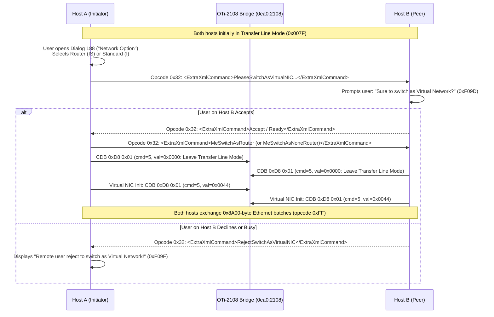

# OTi-2108 Clean-Room Specification — Part 4: Virtual NIC & Mode-Switch Protocol

## 1. Virtual NIC Architectural Overview

In addition to host-to-host file synchronization (**Transfer Line Mode**, `mode = 0x007F`), the OTi-2108 supports full-duplex **IEEE 802.3 Virtual Ethernet Networking** (**Virtual NIC Mode**, `mode = 0x0044`), allowing two hosts connected via the OTi-2108 USB cable to communicate over TCP/IP, share an Internet connection (ICS/NAT), or browse LAN shares.

### 1.1 Key Hardware & Protocol Insights
1. **Zero USB Re-Enumeration:** The OTi-2108 hardware **never** changes its USB Vendor/Product ID (`0ea0:2108`), USB descriptors, or Mass Storage Bulk-Only Transport (`0x08/0x06/0x50`) endpoints when switching between Transfer Line Mode and Virtual NIC Mode.
2. **Same Vendor CDBs & Same 20-Byte Block Header:**
   - `usbnic.sys` communicates with the OTi-2108 over the exact same Bulk IN and Bulk OUT endpoints using standard 31-byte `USBC` Command Block Wrappers (`dCBWTag = 0x08210827`) and 13-byte `USBS` Command Status Wrappers.
   - It uses the exact same vendor CDBs (`0xF0`, `0xD8 0x00`, `0xD8 0x01`, `0xD9 0x28`, `0xD9 0x2A`) with `"OT"` (`0x4F 0x54`) at bytes 14–15.
   - It uses the exact same **20-byte (`0x14`) Bulk Block Header**, setting the payload opcode byte at offset `+0x14` (byte 20) to **`0xFF`** to distinguish an Ethernet frame batch from `EasySuite.exe` file-sync commands (`0x01..0x39`, `0xA1..0xAC`).

---

## 2. Mode-Switching Handshake (`Transfer Line` $\leftrightarrow$ `Virtual NIC`)

### 2.1 Switching from Transfer Line (`0x007F`) to Virtual NIC (`0x0044`)



### 2.2 Asymmetric Detection (Fallback via `0xD8 0x00 op_type=5`)
Even if one host switches to Virtual NIC Mode before the other host starts `EasySuite.exe`:
- When `EasySuite.exe` polls `0xD8 0x00` with `op_type = 5` (`0x00431C5B` / `0x0041C2B0`) and sees `be16(resp[0..1]) == 0x0044`, it immediately alerts the user with string `0xF042` (`"Remote is running at NetWork Mode!!"`) and offers to switch the local host to Virtual NIC Mode.
- Conversely, in `usbnic.sys` (`0x000116AB`), when `0xD8 0x00 op_type=3` returns `action_code == 4`, `usbnic.sys` checks if `resp[2] == 0x44` to confirm the peer is active in Virtual NIC mode (`[devExt + 0x0A] = 1`).

### 2.3 Legacy Windows Driver-Swap Workflow (`nicinst.exe`, `advdrvins.exe`, `nicsw.exe`, `cis.exe`)
On Windows 98/ME/2000/XP, because `usbstor.sys` claims `USB\VID_0EA0&PID_2108` in Transfer Line mode, the legacy suite swaps the kernel driver for the USB device:
1. **`EasySuite.exe`** extracts resource `NETWORK_EXE` to `%TEMP%\ECNX\nicinst.exe` and runs `nicinst.exe IS` (if Router selected), `nicinst.exe IC` (if Peer of Router), or `nicinst.exe I` (Standard).
2. **`nicinst.exe`** (`0x00401000..0x0040196D`) extracts `ousbnic/` to `%ProgramFiles%\ousbnic`, runs `advdrvins.exe` (which calls `UpdateDriverForPlugAndPlayDevicesA(NULL, "USB\\VID_0EA0&PID_2108", "...\\otinic.inf", INSTALLFLAG_FORCE, ...)` to replace `usbstor.sys` with `usbnic.sys`), and launches `nicsw.exe` (`IS` / `IC` / `I`).
3. **`nicsw.exe`** (`0x00401000..0x004024FF`) creates tray window `"NetStorageSW"`:
   - If launched with `IS` (Server/Router), runs `cis.exe s` to enable Windows Internet Connection Sharing (assigning `192.168.0.1/24` and starting DHCP/NAT).
   - If launched with `IC` (Client), runs `cis.exe c` to configure the Virtual NIC for DHCP.
   - When the user double-clicks the tray icon or chooses `"Switch to Transfer Line"` (`Menu 130` ID `32771`), `nicsw.exe` runs `cis.exe r` (restoring network settings), runs `AdvDrvIns.exe -su` (switching `USB\VID_0EA0&PID_2108` back to `usbstor.sys`), and launches `EasySync.exe`.

---

## 3. `usbnic.sys` USB Bulk-Only Transport CDB & CBW Catalog

`usbnic.sys` (`ImageBase = 0x00010000`, `DriverEntry = 0x00010B30`) constructs 31-byte `USBC` CBWs (`dCBWSignature = 0x43425355`, `dCBWTag = 0x08210827`, `bCBWLUN = 0`, `bCBWCBLength = 16`) at 5 functions and submits them as `URB_FUNCTION_BULK_OR_INTERRUPT_TRANSFER` (`0x0009`) to `USBD.SYS` (`0x00011AC8..0x00011B60`), followed by a 13-byte CSW read (`0x00011B3A`):

| Function VA | CBW Site VA | 16-Byte CDB (`CBWCB`) | `bmCBWFlags` | `dCBWDataTransferLength` | Purpose in `usbnic.sys` |
| :--- | :--- | :--- | :---: | :---: | :--- |
| `0x0001199C` | `0x000119C0` | `F0 00..00 4F 54` | `0x80` (`IN`) | `12` (`0x0C`) | **Identify OTi-2108:** Called at `0x00010D6F` (`MiniportInitialize`); verifies `resp[2..3] == 21 08`. |
| `0x00011A32` | `0x00011A66` | `D8 00 <op> <p_hi> <p_lo> 00..00 4F 54` | `0x80` (`IN`) | `2` (`op=2`) or `7` (`op=3`) | **Read Status / Poll:** Called with `op=2, len=2` at `0x000118AD` (query link speed) and `op=3, len=7` at `0x00011640` (poll loop). |
| `0x00011AC2` | `0x00011AE3` | `D8 01 <cmd> <v_hi> <v_lo> 00..00 4F 54` | `0x00` (`OUT`) | `0` | **Write Bridge Control:** Called at `0x00010934` (`cmd=5, val=0x0044` enter NIC mode), `0x00010A4C` (`cmd=5, val=0x0000` leave NIC mode), and `0x00010970` (`cmd=7/8` flush pipes). |
| `0x00011B66` | `0x00011B8F` | `D9 28 00 00..00 4F 54` | `0x80` (`IN`) | `35,328` (`0x8A00`) | **Bulk Read Ethernet Batch:** Reads one `0x8A00`-byte block containing one or more Ethernet frames (`0x000116D0`). |
| `0x00011C14` | `0x00011C40` | `D9 2A 00 00..00 4F 54` | `0x00` (`OUT`) | `35,328` (`0x8A00`) | **Bulk Write Ethernet Batch:** Writes one `0x8A00`-byte block containing one or more Ethernet frames (`0x00011689`). |

---

## 4. `0x8A00` (34.5 KB) Bulk Ethernet Frame Batching Format

In Virtual NIC mode, `usbnic.sys` allocates two `35,328`-byte (`0x8A00`) buffers during `MiniportInitialize` (`0x0001145E`):
- **RX Bulk Buffer:** `[devExt + 0x20]` (`0x8A00` bytes)
- **TX Bulk Buffer:** `[devExt + 0x24]` (`0x8A00` bytes)

### 4.1 Wire Layout of a `0x8A00` (35,328-Byte) Virtual NIC Bulk Block
Both TX (`0x00011906`) and RX (`0x0001170E`) blocks use the **20-byte (`0x14`) Block Header**, followed by **`0xFF`** at offset `+0x14` (byte 20), followed at offset `+0x15` (byte 21) by a sequence of length-prefixed raw IEEE 802.3 Ethernet frames terminated by a `0x0000` length word:

```text
Offset  Size     Type         Field                     Value / Description
+0x0000 4        uint32_le    block_seq_id              0x00000000 (unused/zero in usbnic.sys)
+0x0004 4        uint32_le    msg_seq_id                0x00000000 (unused/zero in usbnic.sys)
+0x0008 4        uint32_le    chunk_index               0x00000000 (always single-block per batch)
+0x000C 4        uint32_le    total_chunks              0x00000001 (always 1)
+0x0010 4        uint32_le    chunk_payload_len         0x00008A00 (35,328)
+0x0014 1        uint8        payload_opcode            0xFF (Virtual NIC Ethernet Batch Marker)
+0x0015 2        uint16_le    frame_1_len (L1)          Byte length of Ethernet Frame 1 (14..1514)
+0x0017 L1       bytes[L1]    frame_1_data              Raw IEEE 802.3 frame (DstMAC[6], SrcMAC[6], EtherType[2], Payload)
+0x0017+L1 2     uint16_le    frame_2_len (L2)          Byte length of Ethernet Frame 2 (or 0x0000 if no more frames)
...     ...      ...          ...                       Up to 23 full-sized 1514-byte frames per 0x8A00 block
+End    2        uint16_le    terminator                0x0000 (Stop marker when < 23 frames or buffer full)
```

### 4.2 TX Batch Construction Rules (`0x00011906..0x00011996`)
When the NDIS TX queue (`[devExt + 0x10]`) has pending outbound `NDIS_PACKET`s:
1. Initialize the `0x8A00` TX buffer (`buf = [devExt + 0x24]`):
   - Zero the 20-byte header (`+0x00..+0x13`), set `dword [buf + 0x0C] = 1` (`total_chunks = 1`), `dword [buf + 0x10] = 0x8A00` (`chunk_payload_len`), and set `byte [buf + 0x14] = 0xFF` (`0x00011963: or byte ptr [edi+4], 0xff`).
2. Set write cursor `ptr = buf + 0x15` (offset 21) and `frame_count = 0`.
3. While `frame_count < 23` (`0x17`, checked at `0x00011986`) and the TX packet queue is non-empty:
   - Dequeue one Ethernet packet and copy its scatter-gather NDIS buffers into `ptr + 2`, obtaining total length `frame_len` (`14 .. 1514` bytes).
   - Write `uint16_le(frame_len)` at `ptr[0..1]`.
   - Advance `ptr += 2 + frame_len`.
   - Increment TX packet counter (`[devExt + 0x48]`) and `frame_count`.
4. If `frame_count < 23`, write `uint16_le(0x0000)` at `ptr[0..1]` (`0x0001198B: and word ptr [esi], 0`) to mark the end of the batch.
5. Transmit the entire `0x8A00`-byte buffer in a single `0xD9 0x2A` Bulk Pipe Write (`0x00011C14`).

### 4.3 RX Batch Parsing Rules (`0x0001170E..0x00011895`)
When `0xD9 0x28` Bulk Pipe Read (`0x00011B66`) completes into `buf = [devExt + 0x20]`:
1. Verify `uint32_le(buf[0x10..0x13]) == 0x8A00` (`0x0001171F`) and `buf[0x14] == 0xFF` (`0x0001172A: cmp byte ptr [eax+0x14], 0xff`). If either check fails, discard the block.
2. Set read cursor `ptr = buf + 0x15` (offset 21) and `remaining = 0x8A00 - 0x15` (`35,307` bytes).
3. Loop while `remaining >= 2`:
   - Read `frame_len = uint16_le(ptr[0..1])`.
   - If `frame_len == 0` or `frame_len > 0x05EA` (`1514` bytes, `0x00011748`) or `2 + frame_len > remaining`: break out of loop.
   - Extract the raw Ethernet frame `frame = ptr[2 : 2 + frame_len]`.
   - **Packet Filter Check (`0x00011760..0x000117E0`):**
     + Check destination MAC `frame[0..5]` against active `OID_GEN_CURRENT_PACKET_FILTER`:
       - Broadcast (`FF:FF:FF:FF:FF:FF`): accepted if `NDIS_PACKET_TYPE_BROADCAST (0x08)` or promiscuous (`0x20`).
       - Multicast (`(frame[0] & 0x01) != 0`): accepted if `NDIS_PACKET_TYPE_MULTICAST (0x02)` / `ALL_MULTICAST (0x04)` or promiscuous (`0x20`).
       - Directed Unicast (`frame[0..5] == local_mac[0..5]`): accepted if `NDIS_PACKET_TYPE_DIRECTED (0x01)` or promiscuous (`0x20`).
   - Deliver `frame` to the host network stack (`NdisMIndicateReceivePacket` / `TUN/TAP` write) and increment RX good counter (`[devExt + 0x4C]`).
   - Advance `ptr += 2 + frame_len` and `remaining -= 2 + frame_len`.

---

## 5. Virtual NIC Poll Thread State Machine (`0x00011614..0x00011708`)

`usbnic.sys` spawns a dedicated kernel system thread (`PsCreateSystemThread` at `0x000115D2`) that runs `0x00011614`:

1. Determine `has_tx = 1` if the TX packet queue (`[devExt + 0x10]`) has packets waiting, else `0`.
2. Issue CDB `0xD8 0x00` (`op_type = 3`, `param = has_tx`, `dCBWDataTransferLength = 7`) via `0x00011A32`.
3. Inspect `action_code = resp[0]` (`0x00011653`):

   | `action_code` (`resp[0]`) | Handler VA in `usbnic.sys` | Action Taken |
   | :---: | :--- | :--- |
   | **`0` or `1`** | `0x00011675` | **Idle / Link Ready:** If `has_tx == 1` (`[devExt+0x10]` non-empty), immediately builds a `0x8A00` TX batch (`0x00011906`) and sends it via `0xD9 0x2A` (`0x00011C14`). |
   | **`4`** | `0x000116AB` | **Peer Mode Notification:** Checks if `resp[2] == 0x44`. If true, sets `peer_nic_active = 1` (`[devExt + 0x0A] = 1`); otherwise sets `[devExt + 0x0A] = 0`. |
   | **`5`** | `0x000116BE` | **Remote Has Ethernet Batch(es):** Extracts `count = be16(resp[1..2])`. Loops `count` times calling `0xD9 0x28` (`0x00011B66`, `0x8A00` bytes) and `0x0001170E` (RX batch parser). |
   | **`6` or `7`** | `0x00011675` | **Bridge Ready for TX Batch:** Builds a `0x8A00` TX batch (`0x00011906`) and writes it via `0xD9 0x2A` (`0x00011C14`). |

4. When the TX queue is empty and `action_code` is idle, waits on `[devExt + 0x70]` (`KeWaitForSingleObject`) with a **10 ms (`-100,000` $\times$ 100ns = `0xFFFE7960`) polling interval** (`0x000116F6`).

---

## 6. MAC Address Generation & NDIS Adapter Properties

### 6.1 Dynamic Unicast MAC Address Generation (`0x00011176`)
Because the OTi-2108 bridge does not contain an IEEE-assigned MAC EEPROM, `usbnic.sys` generates a 6-byte Ethernet MAC address during `MiniportInitialize` (`0x00011176`):
1. Queries the 64-bit system clock (`KeQuerySystemTime(&t)`).
2. Computes `mac[0..5]` from the clock ticks and clears **Bit 0 (I/G multicast bit) of Byte 0** (`mac[0] &= 0xFE`, `0x0001119C: and al, 0xfe`) so it is always a valid individual/unicast Ethernet address.
3. Supports overriding the MAC address if `NetworkAddress` is present in the adapter configuration (`NdisReadNetworkAddress`).

> [!TIP]
> **Clean-Room Recommendation:** A clean-room implementation should generate a deterministic locally-administered unicast MAC address (`02:0E:A0:xx:xx:xx`, where bit 1 of byte 0 is `1` and bit 0 is `0`, seeded by machine-id + USB bus/port path) or allow user configuration.

### 6.2 Adapter Parameters (`0x000102C0` & `0x0001053A`)
- **Maximum Frame Size (`OID_GEN_MAXIMUM_FRAME_SIZE`):** `1500` bytes (`0x05DC`).
- **Maximum Total Frame Length (`OID_GEN_MAXIMUM_TOTAL_SIZE`):** `1514` bytes (`0x05EA`).
- **Transmit / Receive Buffer Space:** `35,328` bytes (`0x8A00`, `1514 * 23` frames).
- **Link Speed (`OID_GEN_LINK_SPEED`, `0x00011898`):** Queries `0xD8 0x00` (`op_type = 2`, 2 bytes):
    - `resp[1] == 0x20` $\rightarrow$ `480 Mbps` (`4,800,000` in 100 bps NDIS units).
    - `resp[1] == 0x11` $\rightarrow$ `12 Mbps` (`120,000` in 100 bps NDIS units).

---

## 7. Clean-Room Cross-Platform User-Space Implementation Guide

Because `usbnic.sys` is purely a USB Mass Storage BOT client speaking CDBs `0xF0`, `0xD8`, and `0xD9` with `0x8A00`-byte buffers, **no kernel USB driver is required** on modern operating systems:

1. **Linux (`TUN/TAP` + `libusb` or `SG_IO`):**
   - Open `/dev/net/tun` and issue `ioctl(tun_fd, TUNSETIFF, &ifr)` with `IFF_TAP | IFF_NO_PI` to create a Layer-2 virtual Ethernet interface (e.g., `oti0`, MTU `1500`).
   - Send CDB `0xD8 0x01` (`cmd = 5, val = 0x0044`) to the OTi-2108 via `libusb` or `/dev/sgX`.
   - Run the 10 ms poll loop (`0xD8 0x00 op_type = 3`):
     + Pack outbound frames read from `tun_fd` into a `0x8A00` buffer (`total_chunks = 1`, `chunk_payload_len = 0x8A00`, `buf[0x14] = 0xFF`, up to 23 `[u16_le len][frame]` records + `0x0000` terminator) and send via `0xD9 0x2A`.
     + When `action_code == 5`, read `count` `0x8A00` blocks via `0xD9 0x28`, unpack each `[u16_le len][frame]`, and write each Ethernet frame directly to `tun_fd`.
2. **macOS (`utun` / `vmnet` or `TAP`) & Windows (`Wintun` / `OpenVPN TAP-Windows`):**
   - Use standard signed user-space virtual network adapters (`TAP-Windows` / `Wintun`) fed by the same user-space `libusb` / `SPTI` engine. Switching between **Transfer Line Mode** and **Virtual NIC Mode** becomes an instant software state transition (`0xD8 0x01 cmd=5` `0x007F` $\leftrightarrow$ `0x0044`) with zero driver reinstallation!
